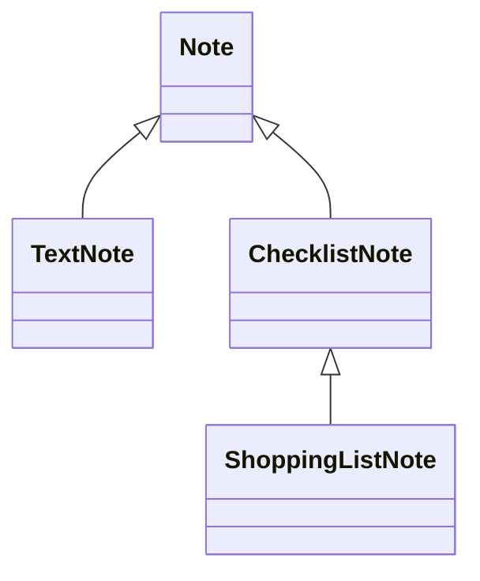

# Personalnotate

Консольний застосунок для ведення персональних нотаток на Java.

Лабораторна робота №6 — реалізація ієрархії класів на основі принципів наслідування.

## Можливості

| Команда | Дія |
| --- | --- |
| 1 | Додати одну або декілька нотаток |
| 2 | Переглянути список назв і відкрити нотатку |
| 3 | Показати та порахувати за пріоритетом |
| 4 | Відсортувати за пріоритетом |
| 5 | Знайти за повним збігом |
| 6 | Змінити формат відображення |
| 7 | Переглянути статистику |
| 8 | Змінити стан пункту списку |
| 0 | Завершити роботу |

Після виконання дії програма повертається до меню.

## Типи нотаток

Текстова нотатка містить звичайний текст і додаткове поле джерела.

Список справ містить пункти, які можна позначати виконаними та знову невиконаними.

Список покупок є різновидом списку справ і додатково містить назву магазину. Позначений пункт означає придбаний товар.

Спільні поля всіх типів:

- назва — непорожній рядок;
- текст — опис нотатки;
- категорія — довільний рядок;
- пріоритет — ціле число від 1 до 10; 1 є найвищим;
- запланований час — скінченне невід’ємне число у хвилинах.

Час додатково показується в годинах із двома знаками після крапки. Значення 0 означає, що час не заплановано.

Текст і категорія можуть бути порожніми. Порожнє джерело або магазин відображається як «не вказано». Кожен список містить від 1 до 100 пунктів, введених через меню.

## Робота зі списками

Під час створення всі пункти невиконані.

Щоб змінити стан, оберіть пункт меню 8, потрібну нотатку та номер пункту. Введіть 1 для виконаного або придбаного пункту, 0 — для невиконаного.

Позначка [x] означає виконання, [ ] — відсутність виконання. Програма підраховує кількість виконаних і невиконаних пунктів.

Зміна стану не створює нову нотатку та не збільшує статистику додавання.

## Перегляд, пошук і формати

У списку вибору показуються лише номери та назви нотаток.

Підтримуються повний, стислий формат і «Картка». У повному форматі та картці показуються додаткові поля конкретного типу. У стислому форматі показується короткий підсумок: джерело, кількість виконаних справ або кількість непридбаних товарів і магазин.

Пошук за повним збігом враховує тип, спільні й додаткові поля. Для списків також порівнюються порядок пунктів та їхні стани. При пошуку програма запитує стан кожного пункту окремо.

Сортування за пріоритетом змінює порядок нотаток і відповідні номери.

## Ієрархія класів



TextNote і ChecklistNote є різновидами Note. ShoppingListNote є різновидом ChecklistNote. Отже, для кожної пари виконується відношення «є різновидом».

Note — абстрактний клас зі спільними полями, перевірками та методами. У цій версії створюються лише конкретні типи нотаток. Методи getTypeName() і getSummary() абстрактні, оскільки кожен тип має власну назву та зміст підсумку.

Поля закриті через private. Підкласи використовують гетери. Масиви пунктів і станів копіюються в конструкторі, а getItems() повертає копію.

Усі типи зберігаються в одному масиві Note[]. При обході масиву викликаються перевизначені методи, зокрема getSummary() та toString(). Кожен підклас доповнює результат super.toString() своїми даними.

## Конструктори та обмеження наслідування

Конструктори підкласів викликають super(...). Перевантажені конструктори використовують this(...), щоб не дублювати ініціалізацію.

Для перегляду повідомлень конструкторів запустіть:

```powershell
java "-Dnotes.trace=true" -cp out Main
```

Після створення списку покупок повідомлення з’являються в порядку Note → ChecklistNote → ShoppingListNote, а потім виконується решта короткого конструктора ShoppingListNote після this(...).

Note і ChecklistNote оголошені sealed та явно визначають дозволених прямих підкласів. TextNote і ShoppingListNote є final: у цій моделі вони завершують ієрархію.

При зміні стану пунктів використовується switch із pattern matching. Sealed-ієрархія дозволяє компілятору перевірити повноту обробки типів. ShoppingListNote перевіряється перед більш загальним ChecklistNote.

Посилання Note має базовий оголошений тип, але може містити об’єкт ShoppingListNote. Фактичний тип визначає перевизначений метод під час виконання. Для виклику setCompleted(), якого немає в Note, використовується instanceof ChecklistNote з pattern matching.

## Порівняння нотаток

Note порівнює спільні поля. Підкласи доповнюють equals() і hashCode() своїми полями.

Перевірка getClass() дозволяє рівність лише для однакових фактичних класів. Тому список справ і список покупок не рівні в обох напрямках навіть за однакових спільних даних.

Перевірка через instanceof могла б дозволити базовому класу визнати підклас рівним, тоді як підклас відхилив би порівняння через свої додаткові поля. Обраний getClass() запобігає такому порушенню симетрії.

Перевірити симетрію після компіляції можна через:

```powershell
jshell --class-path out
```

```java
import models.*;
var a = new ChecklistNote("Список", "", "", 1, 0, new String[]{"Хліб"});
var b = new ShoppingListNote("Список", "", "", 1, 0, new String[]{"Хліб"}, "Маркет");
System.out.println(a.equals(b));
System.out.println(b.equals(a));
```

Обидва результати — false. Для виходу з JShell введіть /exit.

Стани пунктів беруть участь у порівнянні, тому їх зміна може змінити hashCode(). У поточній версії нотатки зберігаються в масиві й не використовуються як ключі хеш-колекцій.

## Композиція та попередні лабораторні

NoteDisplay містить NoteFormatter і делегує йому показ. Це композиція: засіб відображення має форматер, але сам не є форматером.

Наслідування від конкретного форматера прив’язало б NoteDisplay до однієї реалізації та не дозволило б змінювати успадкований клас під час роботи. Композиція підтримує перемикання через setFormatter().

Збережено фабрику форматерів, два спостерігачі, адаптер формату «Картка», пошук, сортування та обробку винятків.

## Запуск

Потрібен JDK 25. Файли зберігаються в UTF-8.

У корені проєкту виконайте:

```powershell
chcp 65001
javac -encoding UTF-8 -d out -sourcepath src src/Main.java
java -cp out Main
```

Для дробових чисел використовуйте крапку.

## Зберігання

До 100 нотаток зберігаються в оперативній пам’яті. Після завершення програми нотатки, стани пунктів та статистика втрачаються. Запис у файл або базу даних не виконується.